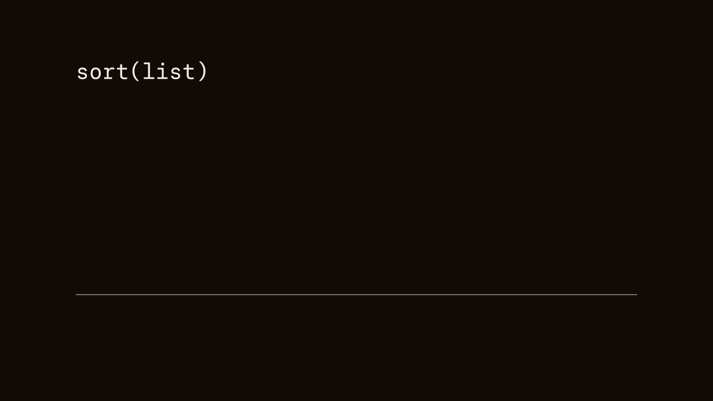
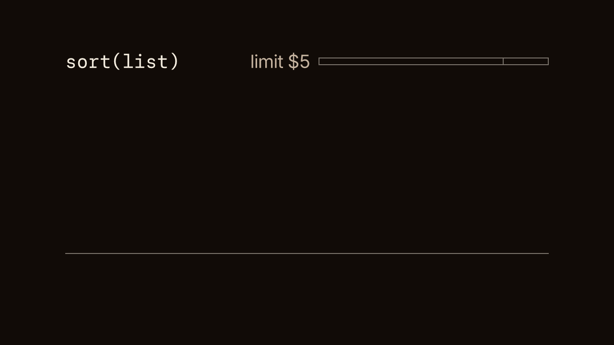

# Eukhe

Eukhe is an agent harness that works a task with no person watching, counts it done only when the user's checks pass on the final code, and gives a report at the end.

## Install

```sh
# macOS (Apple Silicon), Linux (x64, arm64)
curl -fsSL https://eukhe.com/install | sh
```

## Use

```sh
cd project

# start; /login at the first start
eukhe

# log in without the terminal UI; `eukhe login` lists the providers
eukhe login openai-codex

# script; exit 0 only when all checks pass
eukhe -p --accept-cmd 'npm test' "fix the failing tests"
```

In a session, `/accept cmd --protect tests/app.test.js npm test` sets a check. Then type the task. `eukhe --help` shows all commands.

## Checks

<p align="center"><b>Task:</b> "sort the list"<br><br><i>The agent says done. The check passes.</i></p>

<p align="center"><b>Next task:</b> "make the sort faster"<br><br><i>Two values are out of order. The task goes back to the agent.</i></p>

<p align="center"><b>Before a pass counts:</b><br><br><i>Eukhe breaks the code on purpose. The check finds the break.</i></p>

The agent cannot set, change, skip or remove a check. A check that finds less than 80 % of the breaks is weak, and the task ends `checks passed, not certified`. After 3 failed checks in sequence, the task ends `failed`.

When every check finds enough breaks, up to two attackers each write a wrong version of a changed file and a command with the output that the task requires. An attacker is a model request that does not see the agent's reasoning or answer. When the wrong version passes every check, the command runs on it and on the agent's code. When either one gives another output and a separate model request agrees that the task requires the stated output, the task ends `checks passed, not certified`.

## Limits

<p align="center"><br><i><code>/budget set cost=5 time=2h</code>: a step that needs the money kept for the report does not start.</i></p>

Each step reserves its maximum cost before it starts. The report gives the work done, the work not done and the limit that stopped it.

## Models

`/login <provider>` with another account adds that account, and `/accounts` lists the accounts with their usage limits. When an account reaches a usage or rate limit or its login cannot refresh, the run continues with the next account of the same provider and model. When every account is limited, the run waits for the earliest reset within its wait limit.

When a model cannot continue because its retries are used up, its login expired or its usage limit is reached, the run continues with another model that the user configured, then with the default model of each other provider that the user is logged in to. Eukhe shows each change. When no model is left and the provider reports when its usage limit resets, the run waits for the reset; a script run stops at its wait limit and leaves the session waiting. A run that ends because no login can be used ends with the fix: `/login <provider>`. Any other failure ends the run with its report.

## Crash recovery

<p align="center"><br><i>After a crash, completed steps stay complete. An interrupted step runs again when that is safe.</i></p>

Eukhe settles an interrupted step from its evidence: the file content, the git ref or the job exit. A step that is not safe to repeat is treated as not run, and the run continues. The message at the end of the run lists these steps with their cause, and `/effects` shows them. When the process that runs a session hangs or keeps crashing, Eukhe restarts it and the run continues by itself; the agent is told to check the step that was running before it repeats it. This happens at most 3 times a turn; then the run ends with its report.

## Parallel work

<p align="center"><br><i>Two child agents each sort one half at the same time. The parent agent merges the halves.</i></p>

Each child works on its own files in its own copy. A parent can set the checks of a child.

## Report

Each step runs without a question in the terminal, the browser, the phone and a script. After the agent acts, a separate model request reads its final answer; when that request finds work of the task left in the answer, or a question whether to go on, the run continues with that work, also after the checks pass. At the end, one report gives the agent's final answer and the result of each check, and one message lists each irreversible effect that ran, such as a push.

`/undo` puts the files back to their state at the start of the last prompt and names the irreversible effects that it cannot undo; each further `/undo` goes back one more prompt. `/diff` shows what changed since the last prompt started.

## Embed

The npm package `eukhe` runs Eukhe from TypeScript and streams each turn as typed events, ending with the report of the checks and the irreversible effects that ran.

```sh
npm install eukhe && npx eukhe install
```

```ts
import { Eukhe } from "eukhe";

const eukhe = await Eukhe.start({ cwd: "/path/to/project" });
const session = await eukhe.session();
for await (const event of session.prompt("fix the failing tests")) {
  if (event.$ === "Text") process.stdout.write(event.text);
  if (event.$ === "RunReport") console.log(event.report.label, event.report.ran);
}
await eukhe.close();
```

Other languages start `eukhe acp` and speak the [Agent Client Protocol](https://agentclientprotocol.com) over stdio; the budget, checks, `/undo`, `/diff` and irreversible effects are `_eukhe/` methods. Rust embeds the sessions in-process. The protocol, the Rust crate, T3 Code settings and the agent skill: [crates/eukhe-sdk](crates/eukhe-sdk/README.md).

## Limitations

There is no sandbox. Code that the agent runs has the user's permissions and can change the files that a check reads; a check fails on a change only to its `--protect` files. A check that finds the breaks can pass on wrong code that is not similar to a break, for example a hard-coded answer; an attacker finds such code only with a command on an input that the code gets wrong. `/undo` does not restore files that `.gitignore` ignores, files over 16 MiB or nested repositories. A model request that a crash interrupts is not sent again, and its reserved cost stays counted until its usage is known. A limit that is not set has no maximum.

## Credits

Eukhe is a fork of Prime Intellect's [Prime Agent](https://github.com/PrimeIntellect-ai/prime-agent), built on Mario Zechner's [pi](https://github.com/earendil-works/pi). The memory design is Victor Taelin's [OptChat](https://gist.github.com/VictorTaelin/91837951a5ce5b38f341ec1ba1df6449) and [OptMem](https://github.com/VictorTaelin/OptMem). The edit tools, the tokenizers and the harness design come from [oh-my-pi](https://github.com/can1357/oh-my-pi), and the Claude tokenizer vocabulary from Sander Land's [ctok](https://github.com/sanderland/ctok). Made by [Gil Rodrigues](https://gildrb.com). Notices: [THIRD-PARTY-NOTICES](THIRD-PARTY-NOTICES).

## License

MIT. See [LICENSE](LICENSE).
